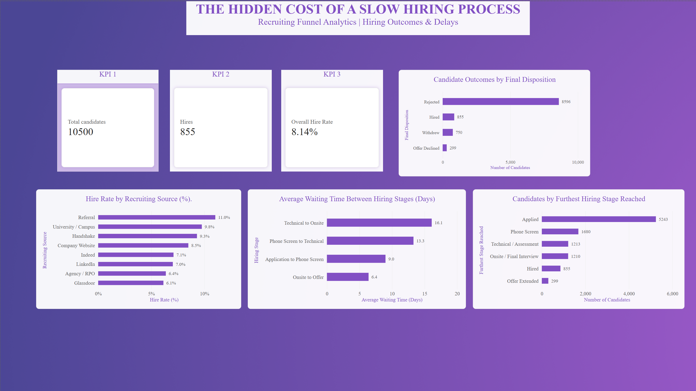

# The Hidden Cost of a Slow Hiring Process
### Recruiting Funnel Analytics | SQL · Power BI · DAX

## 📌 Project Overview

How can recruiting teams identify bottlenecks, understand candidate outcomes, and improve the efficiency of their hiring process?

This project analyzes **10,500 recruiting records** to explore candidate progression, hiring outcomes, recruiting-source performance, and waiting times between hiring stages.

Using SQL for data exploration and validation and Power BI for data visualization, this project translates recruiting data into actionable business insights and recommendations for recruiting teams.

> **Business objective:** Identify potential hiring-process delays, investigate where candidate records stop progressing, and prioritize areas for further analysis.

## 🎯 Business Questions

- Where do candidate records stop progressing through the recruiting funnel?
- Which hiring-stage transitions have the longest average waiting times?
- How do observed hiring outcomes vary across recruiting sources?
- What do final candidate dispositions reveal about the recruiting process?
- What actions could recruiting teams investigate to improve process efficiency and candidate experience?

## 📊 Dashboard Preview

<!-- Upload your Power BI dashboard screenshot to the images/ folder, then uncomment the line below. -->
<!--  -->

*Dashboard preview coming soon.*

The Power BI dashboard includes:

- **KPI cards:** Total candidates, total hires, and overall hire share.
- **Candidate outcomes:** Distribution of final dispositions.
- **Furthest stage reached:** Number of records by the furthest recorded recruiting stage.
- **Waiting-time analysis:** Average time between consecutive hiring stages.
- **Recruiting-source comparison:** Observed hire share by candidate source.

## 🔍 Key Findings

### 1. Technical-to-Onsite is the longest average wait

The average waiting time from Technical / Assessment to Onsite / Final Interview is approximately **16.1 days**, followed by Phone Screen to Technical / Assessment at **13.3 days**.

**Business implication:** These transitions are promising areas to investigate for scheduling delays, interviewer availability, and handoff inefficiencies.

**Recommended action:** Review stage timestamps, scheduling workflows, and decision turnaround times to determine whether delays can be reduced.

### 2. Many records have Applied as their furthest recorded stage

A total of **5,243 records (49.9%)** list Applied as the furthest recorded stage.

**Business implication:** Early-stage application review and screening warrant further investigation.

**Recommended action:** Examine application-review backlogs, time to first contact, and recorded reasons for rejection or withdrawal.

*Note: Furthest stage reached does not establish that a candidate dropped out. Records may reflect different final outcomes.*

### 3. Observed hire shares vary across recruiting sources

| Recruiting source | Observed hire share |
|---|---:|
| Referral | 11.0% |
| University / Campus | 9.8% |
| Handshake | 9.3% |
| Company Website | 8.5% |
| Indeed | 7.1% |
| LinkedIn | 7.0% |
| Agency / RPO | 6.4% |
| Glassdoor | 6.1% |

**Business implication:** Recruiting-source outcomes differ descriptively, but the differences may reflect job mix, candidate mix, hiring volume, and selection practices.

**Recommended action:** Compare sources across similar roles and seniority levels, and consider recruiting cost and candidate quality before reallocating sourcing resources.

### 4. Rejections account for most recorded final outcomes

| Final disposition | Records | Share of all records |
|---|---:|---:|
| Rejected | 8,596 | 81.9% |
| Hired | 855 | 8.1% |
| Withdrew | 750 | 7.1% |
| Offer Declined | 299 | 2.8% |

**Business implication:** Rejections, withdrawals, and declined offers should be examined separately to understand where further process improvements may be appropriate.

**Recommended action:** Analyze rejection reasons, withdrawal timing, and offer-decline patterns rather than treating every unsuccessful outcome as a process failure.

## 💡 Business Recommendations

Based on the findings, the following actions are recommended for further investigation:

1. **Investigate stage-level delays:** Establish turnaround targets and review scheduling between technical assessments and final interviews.
2. **Improve early-stage visibility:** Monitor application-review backlogs and document why records do not progress.
3. **Evaluate sourcing effectiveness:** Compare recruiting sources within similar job categories and include cost-per-hire data where available.
4. **Understand candidate loss:** Separate rejections, withdrawals, and declined offers to identify different opportunities for improvement.
5. **Strengthen data quality:** Standardize stage definitions, validate timestamps, and use consistent duration calculations.

## 🛠️ Tools & Technologies

- **SQL:** Data exploration, aggregations, outcome analysis, and duration validation.
- **Power BI Desktop:** Dashboard development, KPI cards, and interactive visualizations.
- **DAX:** Measures for hire share and average waiting times.
- **Data validation:** Comparison of supplied stage-duration fields against calculations derived from stage dates.

## ⚙️ Methodology

1. **Data exploration:** Reviewed record counts, field completeness, stage distributions, final dispositions, and recruiting-source outcomes.
2. **Data validation:** Compared supplied stage-duration values with date-derived calculations.
3. **Metric development:** Created measures for candidate counts, hires, hire share, and average waiting time between stages.
4. **Visualization:** Built a Power BI dashboard to communicate hiring outcomes, furthest stages reached, waiting times, and source-level differences.
5. **Business interpretation:** Translated descriptive findings into recommendations for further investigation.

## 📈 Key Metrics

| Metric | Value |
|---|---:|
| Total records | 10,500 |
| Hired records | 855 |
| Overall hire share | 8.14% |
| Longest average stage wait | 16.1 days |
| Records with Applied as furthest stage | 5,243 |
| Share with Applied as furthest stage | 49.9% |

## ⚠️ Data Limitations

- The dataset is **synthetic**; findings are illustrative and do not represent a real employer's recruiting performance.
- Furthest stage reached is not equivalent to confirmed candidate dropout or a stage-to-stage conversion rate.
- Recruiting-source comparisons are descriptive and do not establish causation or prove that one source is inherently better.
- The overall hire share is the percentage of records marked Hired, not necessarily a standardized applicant-to-hire conversion metric.
- The supplied Technical-to-Onsite duration field showed substantial inconsistency with date-derived calculations. The date-based measure was used for this transition.
- Observed averages may depend on the records included and the treatment of missing dates.

## 🚀 Conclusion

This project demonstrates how recruiting data can be explored, validated, and translated into business-focused reporting. By identifying potential stage-level delays, examining recorded candidate outcomes, and comparing recruiting sources, the analysis provides a starting point for evidence-based recruiting process improvement.
The next step would be to validate the findings against real operational data and track whether targeted changes improve turnaround times, candidate experience, and hiring outcomes.
---
**Project type:** HR Analytics / People Analytics  
**Tools:** SQL, Power BI, DAX  
**Dataset:** Synthetic recruiting funnel data  
## Hiring Process Analytics Dashboard

